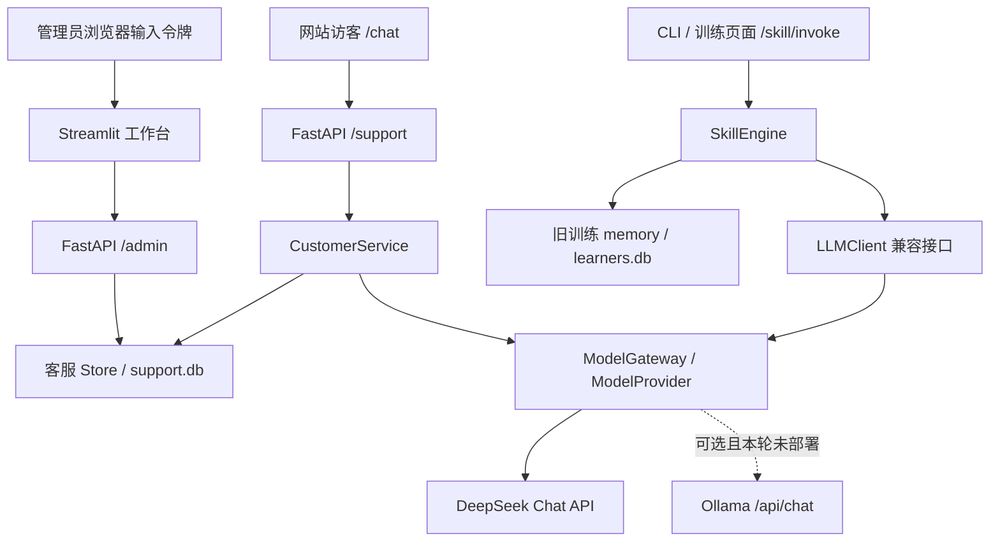

# AI Sales Agent V1 架构

本轮在原销售训练项目上增量增加网站文字客服。已实现代码接口和离线验证链路；真实 DeepSeek 调用须通过独立验收，配置存在不代表调用成功。改造前情况见 [PROJECT_AUDIT.md](PROJECT_AUDIT.md)。

## 调用与数据边界

| 位置 | 当前职责 |
| --- | --- |
| `core/model_gateway.py` | `ModelProvider` 抽象、DeepSeek/Ollama Adapter、配置、同步/流式调用、安全错误、真实 usage 与可选估算 |
| `core/llm_client.py` | 维持原训练 `chat()` 返回字符串接口；通过网关调用，保留原测试兼容点 |
| `core/roleplay.py`、`skill_engine.py` | 客户人设训练、轮次、评分及训练记忆；与真实访客会话分开 |
| `core/scorer.py` | 严格解析模型评分、难度校准、空销售文本规则零分；无效模型评分拒绝存档 |
| `customer_service/service.py` | 风险路由、检索、模型资料选择、后端事实渲染、需求记录及人工接管编排 |
| `customer_service/store.py` | 独立 SQLite 数据访问、会话授权、商品/知识/消息/线索/接管/usage |
| `agent_skill/api_server.py`、`support_api.py`、`auth.py` | 访客与管理 API、鉴权、安全错误，以及同源访客页面 |
| `demo/app.py`、`support_admin.py` | 保留训练页面，增加商品知识、客服测试、会话、人工队列、模型状态与成本页面 |
| `web/customer.html`、`customer.js` | 同源网站文字咨询、可选联系表单、人工申请和手动刷新回复 |

## 模型网关

`ModelConfig` 从服务端环境读取 Provider、模型、地址、超时和可选单价。DeepSeek 使用官方兼容 Chat 接口；配置默认地址为 `https://api.deepseek.com/v1`，请求 `/chat/completions`。模型名可由 `DEEPSEEK_MODEL` 覆盖；应以账户当前可用模型为准。

配置在创建网关时读取，已创建的客服 API 网关持有该配置快照，不会自动重读后来修改的 Secret 或 `.env`。更新配置后需重新启动服务并确认云环境已注入更新，随后重新验证；状态页不能替代这一过程。

`ModelResult` 返回文本、实际 Provider、模型、可获得的 prompt/completion tokens 和估算费用。`ModelError` 仅返回固定安全的 code/public_message/blocked，不透出上游正文、Authorization 或凭据。鉴权、限流、超时、网络和服务不可用有明确错误路径；SSE/本地流在缺少结束标志或数据无效时失败。

网关只使用明确选择的 Provider，不因真实 Adapter 失败悄悄切换云端。旧 `LLMClient` 仍保留针对旧扩展非类型异常的兼容重试/fallback，实际 Adapter 的 `ModelError` 直接返回失败。Gemini/Claude 为历史兼容接口，需显式配置有效模型，不列为本轮真实验收通过项。

状态 `UNVERIFIED` 表示配置通过静态检查；`AVAILABLE` 仅表示当前进程最近请求成功。缺少 Key、无效配置或请求失败显示 `BLOCKED/ERROR`；状态查看本身不探测服务。Ollama Provider 已实现 HTTP 合约，本轮没有安装守护进程或下载模型，默认模型为空时不可用。

## 客服闭环

1. 网站先展示对话保存和使用告知。创建会话返回随机 ID、仅在创建时返回的原始会话 token 和告知版本；浏览器用 `sessionStorage` 保留访问能力。
2. 后端对每次会话读取、消息、联系线索和人工申请验证 `X-Session-Token`。数据库仅存 SHA-256 token hash，并使用常量时间比较，不返回 hash。
3. 客户消息先做有限的联系方式/凭据模式脱敏，再保存消息。需求摘要是最多 600 字的近期脱敏消息拼接，不是模型生成的客户画像。脱敏模式无法保证识别所有敏感信息，页面要求不要提交此类内容。
4. 投诉、付款/退款、特殊优惠、人工请求和部分越权模式直接转人工。寒暄是明确标注的规则回复。知识不足时不编造回答。
5. 检索只使用上架商品和启用知识：英文词、数字与中文二元词的交集，加商品名/ID匹配、通用推荐模式和有限会话上下文。最多送入 6 件商品和 8 条知识；这是规则关键词检索，未接入向量数据库或向量 RAG。
6. 模型只返回 JSON 选择器：`product_ids`、`knowledge_ids`、`needs_human`。客户消息、历史和商品/政策正文均作为不可信数据，不能定义系统权限。后端校验类型、数量和候选 ID 范围；模型不能直接生成客户看到的价格、链接或政策。
7. 后端重新读取当前受管理记录，拒绝推理期间已下架/停用的资料，再从 canonical 数据渲染答复与引用。推荐只能指向真实、已上架的商品；价格用整数分存储，当前仅支持 CNY。被选资料若含明确系统指令、改价、私人付款、优惠承诺，或正文价格与结构化价格矛盾，会转人工且不展示该资料。模式检测不能证明所有资料事实正确，仍须管理者审核。
8. 不确定、无效选择或模型异常创建人工队列。异常回答明确 `BLOCKED`，不会用 Mock 冒充成功。接管后会话状态为 `human`，AI 回复暂停；数据库条件写入阻止迟到的模型答复。管理员回复后队列变为 `resolved`，会话继续保持人工状态，本轮没有自动恢复 AI 的接口。
9. 联系线索是独立操作：`consent=true` 才能保存必要姓名、电话/邮箱和需求，并记录同意版本与时间；聊天不会自动提取联系方式。重复提交被拒绝，修改/删除需走人工运维流程。

## 权限与持久化

`/admin/*` 和 `/skill/invoke` 要求 `Authorization: Bearer <ADMIN_API_TOKEN>`。Streamlit 在任何训练或管理内容显示前，要求每个浏览器手动输入服务端配置的令牌；服务端持有凭据不等于自动授权访问者。访客 session token 不能授权后台，也不能读取其他会话。该共享管理员令牌是 V1 的单管理员边界，不是多租户账户/RBAC系统。

旧 `DB_PATH` 数据库保留 `learners/sessions/skills`。新增 `SUPPORT_DB_PATH` 独立保存 `products/knowledge/conversations/messages/handoffs/leads/model_usage`，启用外键及 WAL。接管创建、处理和线索写入使用立即事务，防止并发产生重复待办或重复人工回复。后台可以修改受管理商品资料，但模型没有 SQL、商品写入、库存、订单、付款、退款、优惠或客户资料修改工具。人工回复也不会自动执行交易。

API 训练会话单独保存在进程内，有随机 ID、容量和过期检查及每会话锁；重启会失去尚未完成的训练会话。完整训练记录和客服记录落盘。运行建议单 API worker、单机 SQLite；尚未提供分布式会话、迁移框架、全量删除 API或自动数据保留任务。

## 评分与费用的解释

- 真实训练评分必须完整满足预期维度、每维整数 0–20、总分整数 0–100且总分与维度之和一致；非法结果抛 `ScoringError`，不保存假分数。
- `score_source=model` 与 `rule` 明确区分，空销售文本规则零分不调用模型。旧私有解析接口保留数值兼容，但标记 `legacy_invalid/invalid`，不能作为有效成绩入库。无来源的历史报告显示未验证。
- 原难度倍率 beginner 1.15、intermediate 1.0、hard 0.85 继续保留；只校准总分，维度保持原分，CLI与报告记录公式。
- **已知限制**：每维满分 20，但旧 `memory.get_weak_areas` 默认阈值仍为 70，训练雷达图仍按 100 展示；为保留历史人工评分和原测试，本轮未改量纲，薄弱项/推荐不能视作已校准的能力判断。
- 客服 `model_usage` 记录实际可获得的模型用量。没有 usage 或未配置可信单价时，费用为未知而非 0；如任何调用费用未知，总估算为 `null`，可单独查看已知部分。金额沿用管理员配置单价的币种，系统未验证币种或实际账单，不能默认当作人民币。
- 当前费用页统计客服调用，未覆盖旧训练全部调用，也未实现预算扣款或支付。

## 验证边界

`tests/` 保留原 40 项测试，并新增网关、训练安全、客服场景、API权限及 Streamlit 回归。Mock/规则验证与真实模型验收分别标记；最终运行结果见 [ACCEPTANCE_REPORT.md](ACCEPTANCE_REPORT.md)。历史公开密钥是否撤销、轮换和清理仍未验证，见 [SECURITY.md](../SECURITY.md)。
