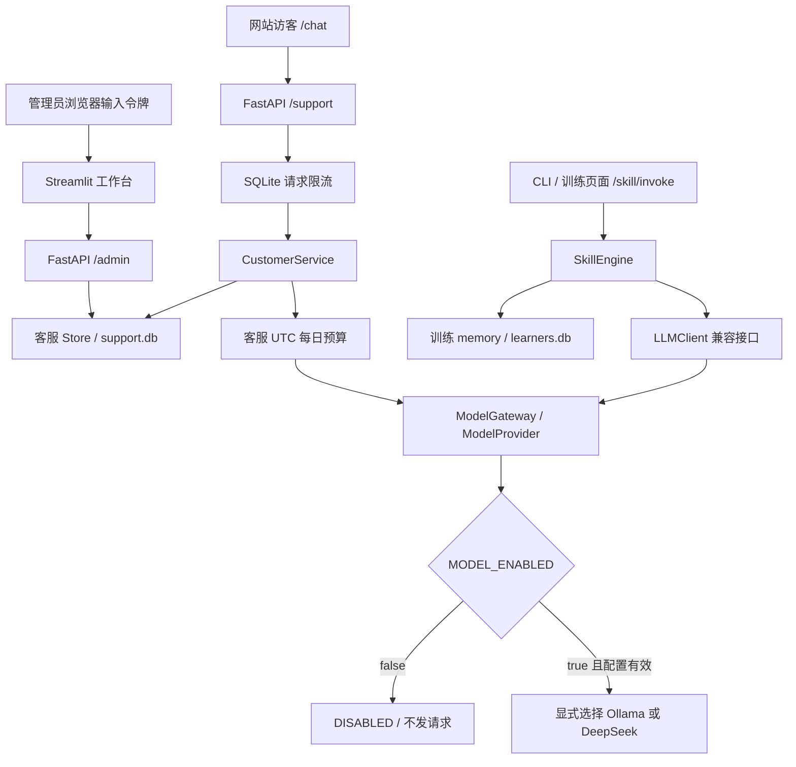

# AI Sales Agent V2 架构

本轮沿用销售训练、FastAPI、Streamlit 和 SQLite，补齐客服业务与隐私闭环，模型最后接入。新部署模板为 `MODEL_ENABLED=false`、`LLM_PROVIDER=ollama`；本轮不安装 Ollama、下载权重或验证真实推理。DeepSeek 仍是可显式选择的云端 Adapter。配置或离线测试通过不能证明真实模型可用。

改造前审计见 [PROJECT_AUDIT.md](PROJECT_AUDIT.md)，V1 历史验收见 [ACCEPTANCE_REPORT.md](ACCEPTANCE_REPORT.md)，本轮结果见 [ACCEPTANCE_REPORT_V2.md](ACCEPTANCE_REPORT_V2.md)。

## 调用与数据边界

| 位置 | 当前职责 |
| --- | --- |
| `core/model_gateway.py` | Provider 抽象、Ollama/DeepSeek Adapter、显式暂停、配置、输入/输出上限、同步/流式请求、安全错误、用量与估算 |
| `core/llm_client.py` | 原训练字符串接口及旧测试兼容点，共享暂停开关与网关 |
| `core/roleplay.py`、`skill_engine.py` | 人设训练、轮次、评分与训练记忆，与访客会话分离 |
| `core/scorer.py`、`memory.py` | 评分合约、来源标识、原分存储、显式量纲归一化与历史兼容 |
| `customer_service/service.py` | 风险路由、检索、模型选择器、事实渲染、需求与人工/隐私编排 |
| `customer_service/store.py` | SQLite 持久化、会话授权与状态、线索/会话删除、保留清理及无正文审计 |
| `customer_service/controls.py` | SQLite 原子请求窗口、客服 UTC 日预算与保守预留 |
| `agent_skill/api_server.py`、`support_api.py`、`auth.py` | 访客/管理 API、鉴权、安全错误及同源页面 |
| `demo/app.py`、`support_admin.py` | 原销售训练与六个客服管理页面，浏览器单独登录 |
| `web/customer.html`、`customer.js` | 同源文字咨询、知情同意、人工、关闭、撤回及确认删除 |
| `scripts/check_local_setup.py`、`run_tests.py` | 无网络静态预检、隔离配置与数据库的离线回归入口 |

## 模型网关与暂停

`ModelConfig` 从服务端环境读取 Provider、模型、地址、超时、开关、输入/输出上限及可选单价。新部署必须保留模板中的 `MODEL_ENABLED=false`；为兼容旧部署，未设置开关的旧环境仍沿用启用行为，未设置 Provider 时也不会自动改写旧配置。只有以后配置实际本地模型后，才显式切换 `true` 并验收。

暂停检查发生在请求前，不需要先取得云密钥或本地模型。页面状态 `DISABLED` 表示主动暂停；真实验收脚本对此返回 `BLOCKED`、原因 `disabled`，网络请求和模型效果为 `NOT_RUN`。离线规则、人工和 Mock 都不能将其变成真实 AI 成功。

`configured` 是静态配置是否完整，`enabled` 是独立调用开关。`UNVERIFIED` 表示配置完整但未请求，`AVAILABLE` 仅表示本进程最近请求成功；失败为 `BLOCKED/ERROR`。查看状态不探测模型。网关持有创建时配置快照，更新 Secret 或 `.env` 后需确认注入并重启 API/Streamlit。

Ollama 使用 `OLLAMA_BASE_URL` 和准确的 `OLLAMA_MODEL` 标签，请求本地 `/api/chat`，不需要 DeepSeek Key，不自动安装守护进程或拉取权重。DeepSeek 保留官方兼容 Chat API，配置默认 `https://api.deepseek.com/v1`，客户端追加 `/chat/completions`；名称可配置且须以账户当前可用模型为准。

`ModelResult` 返回文本、实际 Provider/模型、可获得的输入/输出 tokens 与估算费用。`ModelError` 只穿过固定安全错误，不返回上游正文、请求头或凭据。鉴权、限流、超时、网络、服务不可用和无效数据均有失败路径；流式响应缺结束标志时失败。

所有网关调用按 UTF-8 字节加消息封装余量保守估算输入 token 上界，超限拒绝；输出上限传给 Provider。它不是精确 tokenizer 计数，本地模型还需自行选择适配的上下文与硬件。网关不会因所选 Adapter 失败而静默切换云端；旧 `LLMClient` 只保留非类型旧扩展异常的重试/fallback 兼容，真实 `ModelError` 直接失败。Gemini/Claude 为历史接口，不是本轮验收目标。

`ModelGateway.validate_request()` 与实际请求复用配置、暂停和消息边界校验，返回保守输入估算，不连接模型、不改变最近调用状态。客服在日预算预留前，用完全相同的消息和系统说明预检；本地可判定的超长输入转人工，不创建预算预留。实际发出后的失败仍保守结算。本轮不截断正文或自动扩大模型上下文。

## 客服闭环与资料安全

1. 网站展示保存及使用告知；创建会话返回随机 ID、仅创建时返回的原始 token 和告知版本。浏览器用 `sessionStorage` 保存访问能力。
2. 每次读取、消息、留资、人工及隐私操作都验证 `X-Session-Token`。数据库仅存 SHA-256 token hash，常量时间比较，不返回 hash。
3. 消息经过有限联系方式/凭据模式脱敏后保存；需求摘要为最近最多 600 字的脱敏消息拼接，不是模型客户画像。脱敏无法保证识别全部敏感信息。
4. 投诉、付款/退款、特殊优惠、人工请求及部分越权模式直接转人工。寒暄标记为规则回复；没有受管理资料时不编造回答。
5. 检索仅使用上架商品及已审核、启用且关联商品在售的知识：英文词/数字、中文二元词、商品名称/ID、通用推荐模式及有限本会话上下文。最多提供 6 件商品和 8 条知识，是关键词检索而非向量 RAG。
   V2.1 对完整商品名/ID限定咨询范围，后续代词继承最近的明确用户型号，不从商品描述或助手回复的旁及型号扩大范围。知识按去除型号共有词后的问题相关性排序，标题命中优先，再补充商品关联，排序后截取前 8 条。重读知识后再次校验关联商品与咨询/选择范围，拒绝错配；答复引用标明适用商品。
6. 暂停/缺配置时不调用模型；可调用时先预留客服日预算。模型只输出 `product_ids`、`knowledge_ids`、`needs_human` JSON；客户消息、历史、商品/政策均为不可信数据，不能定义系统权限。后端验证类型、数量和候选 ID。
7. 后端重读资料，拒绝推理期间下架、停用或改写为待审核的内容，从当前受管理记录渲染事实。商品价格为整数分，仅支持 CNY。资料含明确系统指令、改价、私人付款、优惠承诺或与结构化价格冲突时转人工；有限模式检测不能取代商家审核。
8. 不确定、无效选择、预算不足或模型异常进入人工队列；暂停为 `DISABLED`，不可用为 `BLOCKED`。Mock 显式标记，不伪装成模型结果。人工回复不执行交易。

## 最小知识审核流程

`knowledge` 增量添加 `review_status`（`draft` / `approved`）和 `reviewed_at`；旧行保留并默认待审核。普通 `POST /admin/knowledge` 请求字段保持兼容，不能传入审核元数据。新建或改写标题、正文、类型、关联商品会待审核；仅启停或相同内容重存保留审核结果。

管理员使用 `POST /admin/knowledge/{knowledge_id}/approve`，提交 `confirm=true` 和列表当前的 `expected_updated_at`。后端在同一 SQLite 写事务内比较保存版本再盖审核时间戳；版本不同返回 409，不存在返回 404。后台展示保存快照供核对，并把确认状态绑定到记录及其保存版本，避免批准未看到的新内容。此流程没有历史版本库、审核人身份体系、有效期或冲突管理。

## 会话状态与数据生命周期

### 历史答复资料快照

`messages.evidence_json` 为可空 JSON 文本列，首次升级增量添加，旧消息留空且不回填。客服选择器的成功路径把后端复核并实际渲染的 `products` 和 `citations` 传给 `add_ai_message_if_active`；Store 按固定字段白名单复制为 `version=1` 的快照，与答复正文写入同一行/事务。最多 6 件商品和 8 条知识，不保存未选候选、原始模型输出、提示词或运行配置。商品留存名称、描述、分价、币种、链接、启停与更新时间；知识留存标题、正文、类型、关联及显示名称、启停、更新时间和审核状态/时间。

写入继续要求会话为 `ai` 且 `ai_epoch` 匹配；接管、关闭、删除或旧代次导致消息被丢弃时，不会留下孤立快照。资料后续更新不更改历史消息。规则、人工和降级消息不写该快照，Mock 选择仍以 `mock_selection` 来源识别。

授权的 `GET /admin/conversations/{id}` 在消息中附加 `evidence`（对象或 `null`），Streamlit“客户会话”展示并警示历史事实不代表当前价格/政策。访客历史 `GET /support/conversations/{id}` 保留原消息字段且不查询快照列；内部检索/状态读取也不加载历史快照。没有提供快照编辑接口，消息删除及保留清理自然移除此列数据。这是答复事实追溯，不是全部资料的历史版本、模型推理过程、审核人身份记录或防篡改证据。

会话状态为 `ai / human / closed`。接管后 AI 暂停，管理员处理待办并回复后，接管记录为 `resolved`，会话仍为 `human`。恢复必须通过管理员显式操作，并在没有 `pending` 接管时允许；恢复不改变模型全局开关。关闭会话会结束未完成的接管，禁止继续消息、留资、接管或恢复；要继续咨询需新建。

会话 `ai_epoch` 在状态变化时递增，模型回复写入同时检查状态和原 epoch，丢弃接管、关闭或恢复前启动的迟到推理。删除中的请求不会重新创建会话或消息。状态与关键写入使用 SQLite 事务，防止重复待办/人工回复和状态竞态。

联系线索是独立操作：只有 `consent=true` 才保存必要姓名、联系方式、需求、同意版本和时间；不从聊天自动提取，重复提交拒绝。访客持自己凭证或管理员授权后，可确认撤回线索或确认删除会话。撤回只删线索；删除会话会移除消息、接管、线索、用量及关联预算预留详情。每日全局预算聚合不随之清零，不能通过删除绕过限额。

管理员保留清理先预览、再明确确认；后端每次执行重新检查“已关闭、最后活动超过指定天数、无待办”条件。默认保留天数来自 `SUPPORT_RETENTION_DAYS`，不会默认启动定时清理。开放或待办会话不进入批量清理。操作审计只保留固定事件、角色、哈希对象标识和时间，不保存正文、联系方式或原 token；审计及备份保留期限由部署方制定。

应用层删除不保证移除历史备份、WAL/磁盘残留，不能声称法证清除。数据仍需文件权限、备份轮换和删除受理流程。

## 权限、持久化与资源控制

`/admin/*` 和 `/skill/invoke` 要求 `Authorization: Bearer <ADMIN_API_TOKEN>`。Streamlit 在任何训练/管理内容显示前，要求每个浏览器输入同一服务端令牌；持有服务端凭据不会自动登录访问者。访客凭证不能授权管理或访问别人的会话。当前是共享管理员令牌边界，没有多租户账户/RBAC。

训练数据库保留 `learners/sessions/skills`，新增评分元数据列时不改写旧原分。客服数据库独立保存商品、知识、会话、消息、接管、线索、用量、审计、请求窗口与预算；旧表使用增量列迁移，启用外键与 WAL。模型没有 SQL、商品写入、订单、库存、支付、退款、优惠或客户数据修改工具。

创建会话按请求客户端地址限流，发送消息按已授权会话限流；SQLite 保存哈希键和窗口计数，不保存原 IP。默认每个来源每小时 20 次创建、每会话每分钟 20 条消息，超限返回 429 与重试提示。代理来源地址须由部署方正确配置；不能盲信任任意 `X-Forwarded-For`，也不能把单机应用限流当作完整公网防护。

客服模型预算在 SQLite 原子预留，按 UTC 自然日共享次数、token 和可选金额上限，对应北京时间每天 08:00 切日。调用前按单次输入/输出最大值预留；失败、崩溃或缺有效用量保留预留，有完整有效用量才结算。次数和 token 上限为 0 表示禁止调用；金额上限启用时须配置同 Provider 的输入/输出单价。无单价/用量显示未知，不假定本地模型零成本。

**每日预算只覆盖客服 `CustomerService`，不覆盖旧 CLI/训练页面/API 训练调用**；训练仅共享网关开关和单次输入/输出限制。费用页也不是全应用总账，配置币种未验证，金额只是估算，不执行扣款。

训练 API 会话在进程内，有过期/容量检查及每会话锁；重启丢失未完成训练。训练结果与客服记录落盘。当前仍建议单 API worker、单机 SQLite，没有分布式会话或通用数据库迁移平台。

## 评分与验证边界

真实模型评分必须满足预期维度、每维整数 0–20、总分整数 0–100 且等于维度之和；非法结果抛错，不保存假分数。`score_source=model / rule` 与状态明确区分，空销售文本规则零分不调用模型，无来源历史报告标为未验证。原难度倍率 beginner 1.15、intermediate 1.0、hard 0.85 保留，只校准总分。

新结果附带 `scale.dimension_max=20 / total_max=100`，数据库保留原分并另存来源/量纲元数据；能力画像只对显式有效量纲归一为百分制，如 `14/20 → 70/100`，雷达图只使用归一化维度。未知旧量纲不自动乘五，不重写历史分数。

为保持原手工分数兼容，`get_weak_areas` 对缺量纲且 `20 < score <= 100` 的旧值仍沿用 70 阈值；这是遗留行为例外，不证明其原量纲，且不会进入 `normalized_dimensions` 或雷达图。缺量纲的 0–20 分和无效量纲不参与弱项判断；旧高分兼容结果不应当作已核验能力结论。

推荐使用 `scripts/run_tests.py --quiet` 隔离运行离线回归，避免运行 `.env` 的暂停设置改变原 Mock 测试前提。Mock/规则、静态预检和真实模型验收分别标记；当前真实模型 `NOT_RUN`，主动暂停的真实验收为 `BLOCKED / disabled`。本轮不提供真实公网部署或商家资料质量通过结论。历史公开密钥撤销/轮换未验证，见 [SECURITY.md](../SECURITY.md)。
