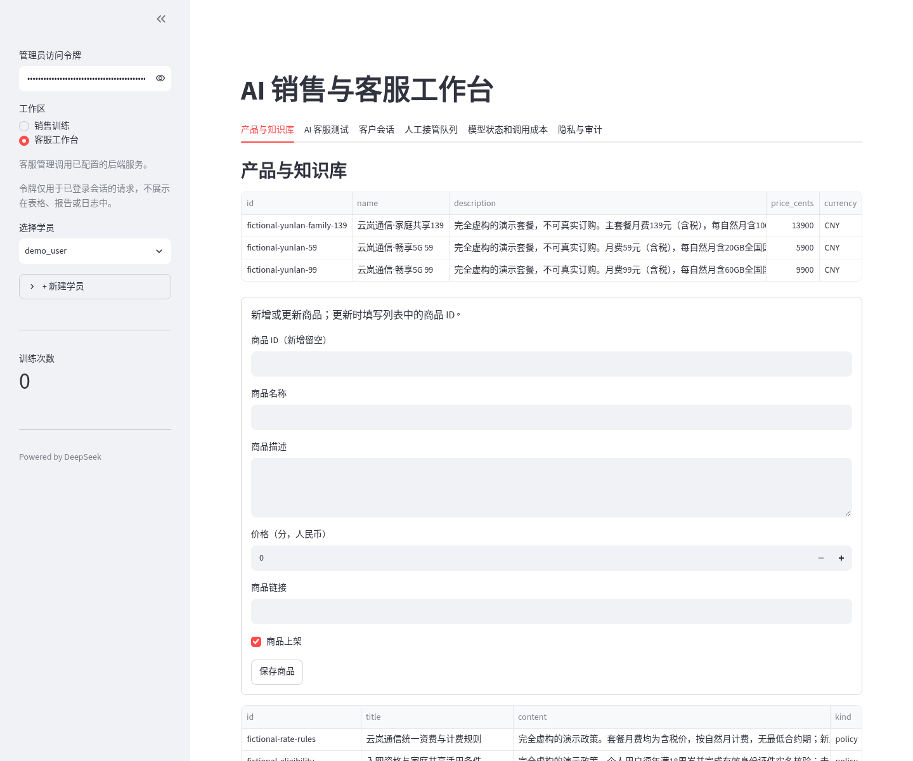
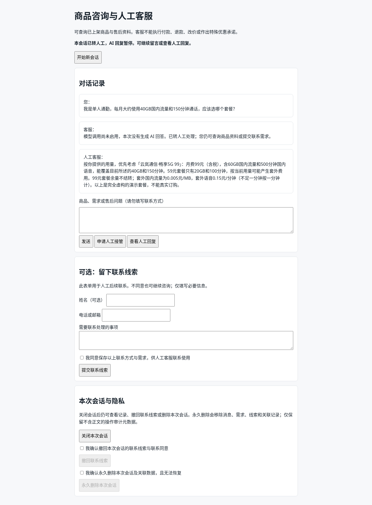
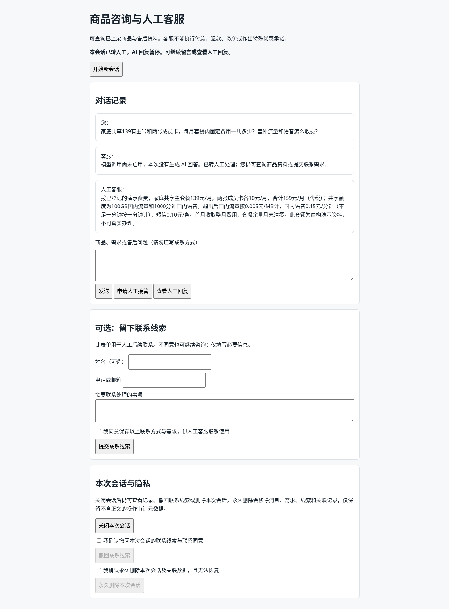
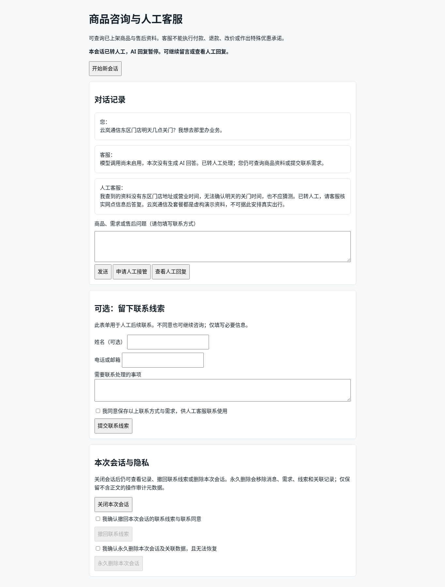

# 销售客服 MVP 演示交付包

## 给第一次了解项目的人

这是一个把“销售新人练习”和“网站文字客服”放在一起的早期工作台。管理员可以维护商品、常见问题和售后政策；访客能在网页上浏览商品、提出问题；系统可以把需要确认的问题交给人工，并把人工回复显示回访客页面。对外演示时使用的是完全虚构的通信套餐，不对应真实运营商、价格或可办理业务。

本次演示验证了真实 FastAPI、Streamlit 管理页、SQLite 和浏览器之间的业务闭环。网站模型被明确关闭（`MODEL_ENABLED=false`）。演示中的回复建议由当前执行任务的 Codex 根据已核实的合成商品和政策资料撰写，再通过现有授权的管理员接管接口发送；这不是网站自动调用 Codex，也不证明任何 AI 模型已经完成客服推理。

## 3 分钟演示流程

| 时间 | 操作 | 展示要点 |
| --- | --- | --- |
| 0:00–0:25 | 说明“云岚通信”及资费均为虚构；打开管理员的“产品与知识库”页 | 后台能读取 3 个商品和已登记的政策/FAQ，资料由真实 HTTP API 提供。 |
| 0:25–0:50 | 打开访客 `/chat`，同意页面提示并查看商品列表 | 展示访客页面、商品浏览；提醒观众这不是公网长期服务。 |
| 0:50–1:30 | 询问“单人每月约 40GB、150 分钟，选哪个？” | 页面显示 `DISABLED` 并转人工；管理员核对商品资料，发送 Codex 辅助拟写的 99 元套餐建议。 |
| 1:30–2:10 | 询问家庭 139 套餐加两张成员卡的固定费用 | 展示可核对的计算：139 + 2 × 10 = 159 元/月，并解释套外费率来自演示政策。 |
| 2:10–2:40 | 问“东区门店明天几点关门？” | 知识库没有门店时间，因此明确不猜、转人工；展示人工答复回到访客会话。 |
| 2:40–3:00 | 打开证据摘要并邀请反馈 | 说明三条会话、三条人工接管及 SQLite 持久化都已核对；网站模型调用次数为 0。 |

演示操作中不要向观众展示管理员令牌或任何访客会话凭证。截图中的访客问题和套餐数据都是合成资料。

## 实际页面截图

以下图片来自本执行环境中的真实 Chromium 浏览器；访客页面由 FastAPI 提供，管理页由 Streamlit 提供。它们不是 Mock 页面。

### 管理端：商品与知识库



### 访客端：套餐推荐咨询与人工回复



### 访客端：费用疑问与人工回复



### 访客端：知识库未覆盖问题转人工



机器可读的精简 HTTP 与数据库证据见 [Codex 辅助人工回复证据](demo-assets/codex-human-reply-evidence.json)。原始执行记录保存在本轮隔离演示目录；交付文件不包含管理令牌、访客会话令牌或内部会话 ID。

## Codex 辅助回复证据与边界

三次访客消息均通过真实 `/chat` 页面提交。真实客服 API 返回 `model_status=DISABLED`、`source=human_handoff`；授权管理员读取待处理队列，并向现有管理员接管接口发送回复。随后访客会话历史接口返回 200，浏览器刷新后显示同一条人工回复。独立 SQLite 最终记录 3 个会话、9 条消息、3 个接管项和 3 条模型使用记录；模型使用记录为 `BLOCKED`，外键检查无错误。

Codex 在本任务执行时读取合成资料并给出建议，再由已有人工权限路径发送。当前产品没有“网站自动请求 Codex”的集成。不能把这次人工辅助流程描述成 AI 自动客服，也不能据此宣称真实模型、模型延迟或 AI 答案质量通过验收。

## 在当前执行环境启动

当前实例复核通过：FastAPI 健康端点返回 `200`，Streamlit `/_stcore/health` 返回 `ok`；访客页面是 `http://127.0.0.1:18080/chat`，Streamlit 管理端是 `http://127.0.0.1:18502`。这些回环地址只在当前执行环境/会话中可访问，环境停止后不保证保留，**项目没有因此上线公网，也没有长期公网地址**。

本次使用隔离目录 `/tmp/sales-telco-demo.naTJyD`、独立 SQLite 和私有运行时环境文件。若该目录仍存在，可在仓库根目录打开两个终端按下面命令重启；环境文件含私有管理员令牌，勿查看、复制、提交或发给他人：

终端一（FastAPI）：

```bash
cd /workspace/sales-skill-ai
set -a
. /tmp/sales-telco-demo.naTJyD/runtime.env
set +a
export MODEL_ENABLED=false
.venv/bin/python -m uvicorn agent_skill.api_server:app --host 127.0.0.1 --port 18080 --workers 1 --no-access-log
```

终端二（Streamlit）：

```bash
cd /workspace/sales-skill-ai
set -a
. /tmp/sales-telco-demo.naTJyD/runtime.env
set +a
export SUPPORT_API_URL=http://127.0.0.1:18080
export MODEL_ENABLED=false
.venv/bin/streamlit run demo/app.py --server.address 127.0.0.1 --server.port 18502 --server.headless true
```

管理员登录令牌须在本机私下从受保护的运行时配置中取得；不要放进命令行分享、截图、仓库或报告。该隔离目录是临时执行环境产物，日后可能不存在。标准本地安装方式和新建隔离数据库的说明见仓库 [README](../README.md)。

## 已实现与未实现的边界

**本次可复核的已有能力：**

- 原销售训练工作台仍在；本交付没有改动训练功能代码。
- Streamlit 管理端通过真实 HTTP API 读取商品、知识和会话/接管信息。
- FastAPI 商品查询、访客文字会话、SQLite 持久化和人工接管/回复链路可运行。
- 三种合成场景（推荐、资费、知识缺口）均完成访客提交、管理员回复、访客读回。
- 模型关闭时页面明确显示 `DISABLED`，并进入人工接管；不冒充模型成功。

**未实现或本次未验收：**

- 网站自动调用 Codex、DeepSeek、Ollama 或其他模型并自动应答；真实模型调用和效果均未验收。
- 长期公网部署、域名、TLS、生产级身份/权限体系、可用性监控及生产数据备份。
- 真实通信商品、库存/订单/付款/退款/订购流程；本演示套餐不可购买。
- 本次演示验证的是人工辅助闭环，不是商业效果；产品市场适配、真实顾客体验和规模容量仍待用户试用验证。

## 给 3 名潜在用户的介绍

“我们在做一个给小团队使用的销售与网站客服工作台：商品和已审核的问答资料放在后台，访客可以在网站文字窗口咨询；遇到资料不足的问题，系统会明确转给人工，避免为了回答而乱猜。我们目前展示的是隔离环境中的早期 MVP，网站自动模型客服尚未接通，演示回复由人工在 Codex 辅助下核对资料后发出。我们想先听听你们最真实的接待流程和顾虑，再决定是否值得继续投入。”

## 5 个反馈问题

1. 你现在怎样处理网站或社交渠道的重复咨询？其中哪一步最耗时？
2. 商品问答、销售训练、会话记录和人工接管里，哪一项对你最有实际价值？为什么？
3. 哪类问题你会允许自动答复，哪类问题一定要转人工？你希望怎样看到答案依据？
4. 访客对话与留资记录需要哪些明确告知、同意和删除方式，才符合你和客户的信任要求？
5. 如果愿意试用，你会用哪些真实但可脱敏的商品/问题验证它？试用成功的标准是什么？
